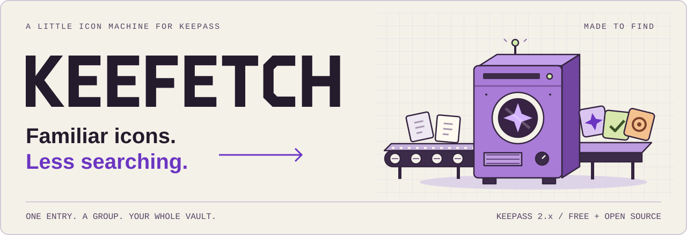
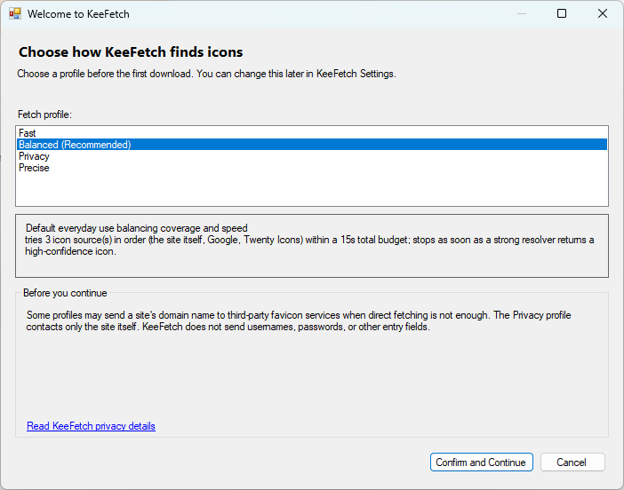
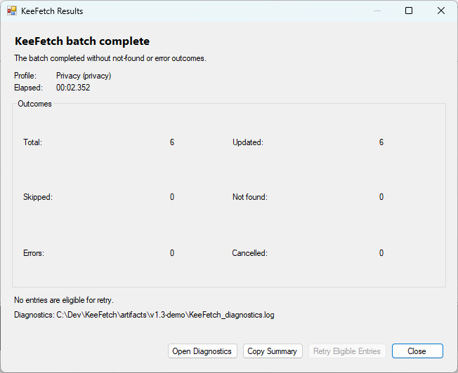
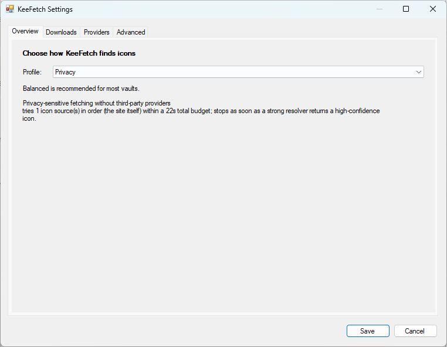
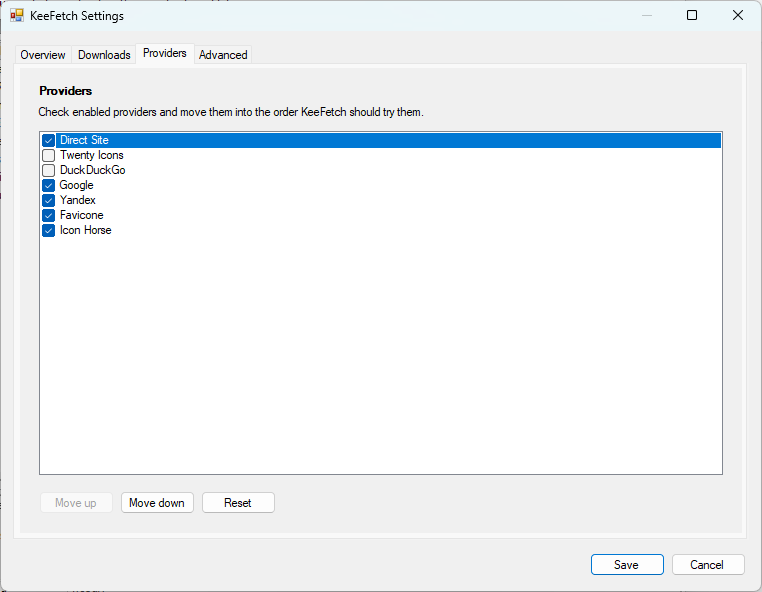

[](https://tzii.github.io/KeeFetch/)

# KeeFetch

**Give your KeePass entries their website icons.** Fetch an icon for one entry, a whole group, or your database, with control over which services are contacted.

[](https://github.com/tzii/KeeFetch/actions/workflows/build.yml) [](https://github.com/tzii/KeeFetch/releases/latest) [](LICENSE)

**[Download KeeFetch](https://github.com/tzii/KeeFetch/releases/latest)** · **[Website](https://tzii.github.io/KeeFetch/)** · **[Getting started](https://tzii.github.io/KeeFetch/getting-started.html)** · **[Release notes](CHANGELOG.md)**

For **KeePass 2.x on Windows** with **.NET Framework 4.8**. Free and open source. No account or telemetry. KeePassXC is not supported.

## Install in a minute

1. Download **`KeeFetch.plgx`** from the [latest stable release](https://github.com/tzii/KeeFetch/releases/latest). Checksums and the alternative DLL are included there.
2. Close KeePass and copy the file into its **`Plugins`** folder. For a portable installation, this is next to `KeePass.exe`; for an installed copy, it is usually `%ProgramFiles%\KeePass Password Safe 2\Plugins`.
3. Start KeePass. Right-click an entry and choose **KeeFetch - Download Favicons**. On the first download, choose a profile; **Balanced** is the default.

Keep only **one** plugin format installed: PLGX or DLL. KeeFetch keeps each changed entry's previous state in its history, like an edit in KeePass (KeePass's history limits apply), and the results window can undo a whole run. A database backup before a large first run is still a good idea. See the [installation and upgrade guide](https://tzii.github.io/KeeFetch/getting-started.html).

## A small plugin that does the sorting

- **One entry or the whole vault.** Fetch from entry and group context menus, or use **Tools → KeeFetch → Download All Favicons**. Groups include their subgroups; the Recycle Bin is left out.
- **Your icons stay yours.** By default, group and database runs skip entries that already have a custom icon; you can change this in Settings. Selected entries are always fetched, so you can replace an icon on purpose.
- **Your providers, your choice.** Two ready-made profiles, Balanced and Privacy, plus Custom settings for provider order, timeouts and fallbacks.
- **Better candidates, fewer duplicates.** Looks for site icons and web manifests, ranks candidates by source and confidence, and deduplicates identical image bytes.
- **Android links included.** Resolves `androidapp://` package names through 100+ built-in mappings and, when enabled, Google Play lookup.
- **Results you can act on.** See what happened to every entry, retry misses once, undo the run, or export a diagnostics report you can share.

Open **Tools → KeeFetch → Settings...** to change profiles, adjust downloads or choose your own providers.

## See it in KeePass

Screenshots from v1.3. More on the [website](https://tzii.github.io/KeeFetch/#screenshots).

### Choose a profile on the first run



### Check the result



<details>
<summary><strong>Settings: overview and providers</strong></summary>

The Overview tab selects a profile. The Providers tab shows the provider controls used when configuring Custom.





</details>

## Choose how icons are fetched

| Profile | Sources, in order | Total budget | Best fit |
| --- | --- | --- | --- |
| **Balanced** (default) | Direct Site → Google → Twenty Icons | 15 s | Finds an icon for most entries. Asks each website first and uses icon services only when the site has no usable icon. |
| **Privacy** | Direct Site | 22 s | Asks only each entry's own website. No icon services and no Google Play lookup, so some entries stay without an icon. |
| **Custom** | Your choice and order | Configurable | Manual control over all seven providers and timeouts. |

Budgets are upper bounds per entry, not typical durations. Balanced stops at the first confident icon, and neither profile falls back to generated icons.

KeeFetch v1.4 retired the Fast and Precise profiles of v1.3. If you used one of them, KeeFetch switches to Balanced and asks you to confirm your choice before the next download.

The profiles come from a [study of 19 provider configurations](docs/benchmarks/v1.3-provider-study.md) over 827 machine-reviewed units. [Compare profiles and providers](https://tzii.github.io/KeeFetch/profiles.html).

## Know where requests go

**Balanced and other resolver-enabled profiles can share entry domains with third-party favicon services.** KeeFetch does not send usernames or passwords and has no telemetry. The first-run dialog explains this before downloading.

**Privacy disables favicon resolvers and Google Play lookup.** Direct Site still follows redirects and site-linked icons or manifests, including those hosted elsewhere. It is not a same-origin network policy.

Recognized private hosts are excluded from resolver lookups, and resolver redirects to recognized private hosts are refused before contact. This uses a lexical classifier: it does not detect every internal DNS name or validate DNS answers. Direct Site can contact private hosts.

Guessing a web address from an entry's title is off by default. When you turn it on, a guessed domain such as `mybank.com` is sent to the profile's services like any other address.

**Diagnostics stay in memory and are written only when you export them.** The exported report numbers entries instead of naming them and removes user names, passwords, query strings and fragments from web addresses. Nothing is written next to your database.

Read the [privacy and network details](https://tzii.github.io/KeeFetch/privacy.html) for provider endpoints, Android lookup, redirects and certificate handling.

## Help and development

- **Installation, missing icons or retries:** [Troubleshooting](https://tzii.github.io/KeeFetch/troubleshooting.html).
- **Bugs and feature requests:** [GitHub issues](https://github.com/tzii/KeeFetch/issues). Include the KeePass/KeeFetch versions, selected profile and steps to reproduce. Remove private data from any attachments.
- **Code and documentation changes:** [Contributing](CONTRIBUTING.md), including architecture, PLGX packaging and all repository checks.
- **Release notes, benchmarks and validation records:** [Documentation index](docs/README.md).

### Build from source

Use Windows, the .NET 8 SDK, the .NET Framework 4.8 targeting pack and KeePass 2.x. Set `KeePassPath` to the directory containing `KeePass.exe`:

```powershell
dotnet build KeeFetch.sln -c Release -p:KeePassPath="C:\path\to\KeePass" -warnaserror
dotnet test KeeFetch.Tests/KeeFetch.Tests.csproj -c Release --no-build
```

The plugin targets .NET Framework 4.8. Production source stays compatible with C# 5 so KeePass can compile the PLGX; the test project uses C# 7.3. See [the contributor guide](CONTRIBUTING.md#development-environment) for packaging and verification commands.

## License and credits

[MIT licensed](LICENSE). Built for [KeePass Password Safe](https://keepass.info/) and inspired by [KeePass-Yet-Another-Favicon-Downloader](https://github.com/navossoc/KeePass-Yet-Another-Favicon-Downloader).

Thanks to [Twenty Icons](https://twenty-icons.com/), [DuckDuckGo](https://duckduckgo.com/), [Google](https://google.com/), [Yandex](https://yandex.com/), [Favicone](https://favicone.com/) and [Icon Horse](https://icon.horse/) for their favicon services.
